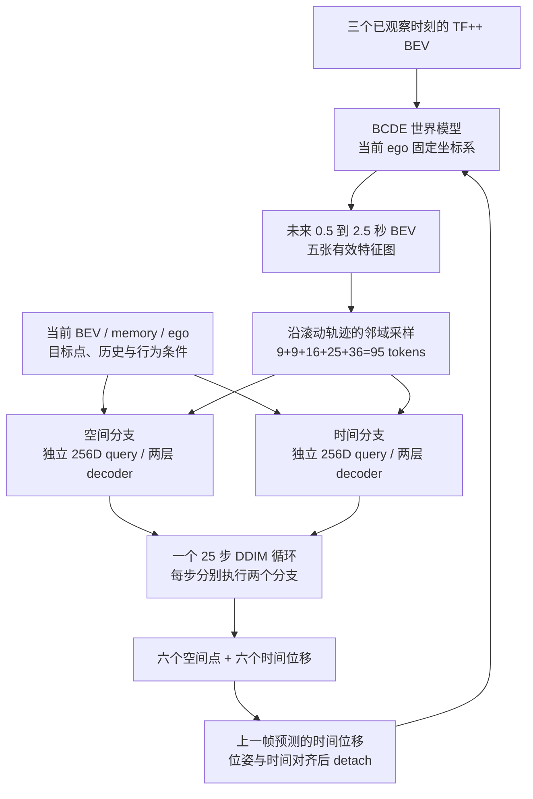

# WAMPC V4：BCDE 世界模型与六点双分支联合训练

本仓库保存 **2026-11-12 完成的一次训练快照**：对应源码、实际训练配置、完整正式日志、验证结果、固定数据索引及启动检查记录。

训练基于 [WAMPC](https://github.com/neasonrum/WAMPC) 的 `full_diffusionv3` 扩展。世界模型使用已在 Bench2Drive PDM-lite 上重新训练的 `irwm_bev_t_large`（BCDE 版），联合训练时参考 [CVCI2_Res_V11_PlanA](https://github.com/123mike-source/CVCI2_Res_V11_PlanA) 的局部解冻、未来 BEV 滚动及轨迹邻域读取策略。来源提交和许可证见 [THIRD_PARTY_NOTICES.md](THIRD_PARTY_NOTICES.md)。

## 训练完成情况

| 项目 | 本次记录 |
|---|---|
| 时间 | 2026-11-12 18:43:44–19:50:44，北京时间，约 67 分钟 |
| 硬件 | 单节点 8×NVIDIA L40，8 进程 DDP |
| 训练量 | 10 轮，218 次更新/轮，共 2,180 次更新 |
| 批量 | 每卡 128，全局 1,024，无梯度累积 |
| 最佳检查点 | 第 5 轮，按验证 future ADE 选择 |
| 验证范围 | 44 条开发集路线、1,906 帧；路线宏平均；25 步 DDIM |

| 检查点 | 空间 ADE ↓（m） | 未来轨迹 ADE ↓（m） | 时间位移 L1 ↓（m） | 行为准确率 ↑ |
|---|---:|---:|---:|---:|
| 第 5 轮，best | 0.05797 | **1.39727** | 0.39176 | 71.297% |
| 第 10 轮，final | 0.06123 | 1.45502 | 0.39519 | 71.435% |

这些指标来自离线开发集。此次快照没有新增 CARLA 220 路线闭环分数。完整逐轮指标见 [validation.csv](results/validation.csv) 与原始 [validation.jsonl](runs/tongji_bcde_joint_seed901_20261112/validation.jsonl)。

## 目录入口

| 内容 | 路径 |
|---|---|
| 正式训练入口 | [`method/full_diffusionv4/joint_train.py`](method/full_diffusionv4/joint_train.py) |
| 本次实际配置 | [`runs/tongji_bcde_joint_seed901_20261112/config.json`](runs/tongji_bcde_joint_seed901_20261112/config.json) |
| 训练配方 | [`method/full_diffusionv4/config_joint.json`](method/full_diffusionv4/config_joint.json) |
| 六点双分支规划器 | [`model.py`](method/full_diffusionv4/model.py)、[`diffusion.py`](method/full_diffusionv4/diffusion.py) |
| 世界模型局部解冻 | [`world_tuning.py`](method/full_diffusionv4/world_tuning.py) |
| 因果滚动与路线流采样 | [`batched_rolling.py`](method/full_diffusionv4/batched_rolling.py)、[`joint_data.py`](method/full_diffusionv4/joint_data.py) |
| BCDE 世界模型结构及预训练实现 | [`method/irwm_bev_t_large/`](method/irwm_bev_t_large/) |
| 正式控制台及指标日志 | [`runs/tongji_bcde_joint_seed901_20261112/`](runs/tongji_bcde_joint_seed901_20261112/) |
| 数据划分与索引 | [`artifacts/dataset_index/`](artifacts/dataset_index/) |
| 原始训练/准备脚本 | [`scripts/original/`](scripts/original/) |
| 环境与依赖版本 | [`environment/`](environment/) |
| 源码来源及哈希 | [`provenance/source_snapshot.json`](provenance/source_snapshot.json) |

`method/full_diffusionv4/config.json` 与 `train.py` 是早期冻结世界模型的入口；**本次运行使用 `config_joint.json` 和 `joint_train.py`**。源码保留原有文件名及实现，未将早期默认配置改写成正式配置。

## 当前架构



- 原空间轨迹从 10 点线性重采样为 6 点，源索引为 `[0, 1.8, 3.6, 5.4, 7.2, 9]`。时间分支输出 6 个连续 XY 位移，间隔 0.5 秒，累计得到未来 3 秒位置。
- 两个分支有独立的查询编码器、时间嵌入和解码层，仍在每个 DDIM 步内依次调用。此快照未实现单个共享解码器同时生成两个分支，也未实现两个 CUDA stream 并发去噪。
- 世界模型输入/输出特征为 `64×64×64`；BCDE 内部主干通道 192、粗尺度通道 384，基础世界模型约 1,483 万参数。规划器只读取前五个有效未来时刻，第六个未来尾部按掩码关闭。
- 五步世界模型滚动和未来 K/V 准备位于 DDIM 循环之外。未来 BEV 保持在输入时刻 ego 坐标系，轨迹位置与采样坐标使用同一坐标约定。
- 第一次观测或先验过期时关闭相应未来条件；不会拿真实未来轨迹作为推理输入。训练标签使用真实未来测量，训练输入只载入三个已观察时刻的教师 BEV。

## 损失与解冻策略

规划损失为 `L_spatial + 2 × L_temporal + 0.4 × L_behavior`：

- 空间：米制空间点的 masked L1；两层空间解码输出均监督。
- 时间：米制连续位移的 masked L1；两层时间解码输出均监督；六个时段权重 `[3,3,2,2,1,1]`。
- 行为：1/2/3 秒的 STOP、DECELERATE、KEEP、ACCELERATE 四分类交叉熵。

联合阶段仅以规划损失反传微调世界模型，没有额外加入 BEV/OCC 重建损失。BCDE 预训练自身的特征重建损失可在 [`method/irwm_bev_t_large/loss.py`](method/irwm_bev_t_large/loss.py) 查看。

世界模型仅解冻 `model.transition.1.*`、`model.decode.*`、`model.action.*`，合计 **1,349,248** 个参数、28 个张量。观察历史编码及其他未选中模块冻结。模型保持 eval 模式，但选中权重保留梯度；采用 FP32/TF32、五步完整 BPTT、非重入激活重算。前帧规划先验 detach，当前五步递归内部完整反传。

| 参数组 | 基准学习率 |
|---|---:|
| 世界模型局部参数 | 1e-6 |
| 迁移的上下文模块 | 1e-5 |
| 迁移的规划模块 | 2e-5 |
| 新增模块 | 1e-4 |
| 未来 gate、当前点 logits | 1e-3 |
| 距离参数 | 1e-2 |

优化器为 fused AdamW；500 次更新预热，随后余弦衰减至基础 LR 的 10%；梯度裁剪 1.0。规划器使用 BF16，世界模型使用 FP32/TF32。未来条件 dropout 为 0.1。**训练生成前帧滚动先验使用 1 步 DDIM；每轮验证和部署使用 25 步**。完整参数分组见 [optimizer_groups.json](runs/tongji_bcde_joint_seed901_20261112/optimizer_groups.json)。

## 数据范围

原始目录为 `/share/home/u21012/data/bench2drive-PDMlite`。训练使用既有质量过滤、路线家族划分及完整三秒未来约束之后的固定子集：

| 范围 | 路线数 | 训练/验证样本数 |
|---|---:|---:|
| 原始 PDM-lite 目录 | 5,368 | 未把全部原始帧作为训练样本 |
| 索引内路线 | 4,844 | 含 4 条没有有效训练 anchor 的路线 |
| 实际训练 | **4,796** | **222,607** |
| 验证 | **44** | **1,906** |

因此，训练覆盖的是**过滤后的 PDM-lite 训练划分**。质量过滤排除 308 条路线；另记录验证家族变体 214 条、官方测试家族排除项 2 个。跳过每条路线前 10 帧，anchor 步长为 2；原始测量间隔 0.25 秒；要求三帧历史和完整未来 3 秒连续观测。训练 anchor 因未来不完整从 241,806 减为 222,607，验证从 2,082 减为 1,906。

该索引由既有过滤/重复规则重建，原集群索引不可用；`split.json` 还保留 1,754 项未映射源模板记录，不能据此宣称已完成所有原始模板的泄漏审计。详见 [源 manifest](artifacts/dataset_index/source/manifest.json) 与 [split.json](artifacts/dataset_index/source/split.json)。

采样使用 1,024 个固定因果路线流。各流分配互斥路线池，池内连续读取并循环，epoch 代表更新预算。重放本次 2,180 次更新的确定性采样：222,607 个训练样本全部访问，共 2,232,320 次抽样；单样本访问次数 1–42，平均约 10.028 次。复核脚本为 [`scripts/audit_sampling.py`](scripts/audit_sampling.py)。

教师 BEV 缓存覆盖 482,906 个必要原始帧；当前帧规划 memory/ego 缓存覆盖 224,513 个训练与验证 anchor。仓库保存划分数组、路线列表、哈希，以及 `source_metadata.zip` 中 4,844 条路线的紧凑数值元数据（帧号、位姿、速度等），用于还原 anchor。传感器图像、点云和大型特征缓存需使用原始数据自行准备。

## 环境与复现

建议在 Linux / Slurm 计算节点上使用 Python 3.10。原运行环境为 Python 3.10.22、PyTorch 2.5.0+cu121、torchvision 0.20.0+cu121、NumPy 1.26.4、diffusers 0.30.3、timm 1.0.11、CARLA Python API 0.9.15。完整实际版本保存在 [pip-freeze.txt](environment/pip-freeze.txt)。

```bash
git clone --recurse-submodules https://github.com/123mike-source/WAMPC-V4-BCDE-Joint-20261112.git
cd WAMPC-V4-BCDE-Joint-20261112
python3.10 -m venv .venv
source .venv/bin/activate
python -m pip install --extra-index-url https://download.pytorch.org/whl/cu121 -r environment/pip-freeze.txt
```

CARLA Garage 以 git submodule 固定在 `48e6a6dbcb133220333bd65e242fbc2b492bb15b`。安装依赖需要兼容 CARLA API、CUDA 和驱动的 Linux 环境；上述 freeze 是原始运行清单，跨平台安装仍需按平台处理可用 wheel。

### 1. 准备模型与原始数据

将下列原始权重及教师配置放到对应路径，并校验 [`weight_dependencies.json`](provenance/weight_dependencies.json) 的 SHA256：

```text
ckps/full_diffusionv3/release/epoch_10.pt
ckps/irwm_bev_t_large/release/best.pt
ckps/full_diffusion/backbone/all_towns_seed1/model_0030_1.pth
ckps/full_diffusion/backbone/all_towns_seed1/config.json
```

本仓库此次上传范围为代码、配置、日志和索引。预训练权重及本次训练产出的 `best.pt`/`latest.pt` 保留在原服务器；精确路径和身份见权重依赖记录。V4 推理需要基础 BCDE 权重与 V4 检查点保存的 `world_tuned_state` 一起恢复。

### 2. 还原固定源索引并配置当前路径

```bash
python scripts/restore_training_index.py \
  --data-root /path/to/bench2drive-PDMlite \
  --carla-root /path/to/CARLA_0.9.15
source scripts/activate.sh
```

该命令校验并恢复索引/数值元数据到 `data/irwm_bev_t/pdm_seed901_dev44_dt05_tongji_v1`，只在恢复副本中调整原始数据路径，并生成 `configs/local_joint.json`、更新本地 `configs/paths.json`。归档在 `artifacts/` 和 `runs/` 中的原始配置保持原样。迁移路径后新生成的 prepared manifest 身份会改变。

### 3. 在已分配 GPU 的计算节点准备缓存

以下命令在现有八卡交互 shell 中执行。也可从 tmux 中使用 `srun --jobid=<已有作业号> --overlap ...` 启动子步骤。

```bash
export TMPDIR="$(mktemp -d /tmp/wampc-v4-prepare.XXXXXXXX)"
source_index=data/irwm_bev_t/pdm_seed901_dev44_dt05_tongji_v1
cache=data/irwm_bev/teacher_cache
cache_run=.runtime/local_teacher_cache
python -m method.irwm_bev_t_large.cache_fill \
  --index "$source_index" --cache "$cache" --output "$cache_run" --scan
torchrun --standalone --nproc_per_node=8 -m method.irwm_bev_t_large.cache_fill \
  --index "$source_index" --cache "$cache" --output "$cache_run" --workers 4
python -m method.irwm_bev_t_large.cache_fill \
  --index "$source_index" --cache "$cache" --output "$cache_run" --verify
python -m method.full_diffusionv4.prepare_joint labels \
  --source "$source_index" --config configs/local_joint.json \
  --output data/full_diffusionv4/pdm_seed901_bcde_v1 --workers 32
torchrun --standalone --nproc_per_node=8 -m method.full_diffusionv4.prepare_joint contexts \
  --config configs/local_joint.json --output data/full_diffusionv4/pdm_seed901_bcde_v1 \
  --workers 4 --batch-size 16
```

原始教师缓存可按相同教师哈希与格式复用。`artifacts/dataset_index/prepared/` 是身份与索引记录，未包含逐帧 labels/context；应执行以上准备步骤生成工作目录，避免将归档的完成标记当成可用缓存。

### 4. 启动或恢复联合训练

```bash
bash scripts/train_joint.sh configs/local_joint.json ckps/full_diffusionv4/local_joint
# 同样八卡、批量和输出目录恢复：
bash scripts/train_joint.sh configs/local_joint.json ckps/full_diffusionv4/local_joint --resume
```

脚本只在现有计算分配内运行训练子步骤，结束后保留原交互式 GPU 分配。原服务器当时的启动脚本和路径保存在 `scripts/original/`，用于核对实际命令。

### 5. 检查

```bash
python scripts/verify_snapshot.py
python scripts/audit_sampling.py
python -m unittest discover -s tests -p 'test_full_diffusionv4*.py'
```

后者需要已安装的 PyTorch/diffusers 等环境；原运行的六项联合训练数值测试、八卡断点恢复和标签核对记录见 [diagnostics](runs/tongji_bcde_joint_seed901_20261112/diagnostics/)。

## 日志说明

`train.log` 是完整控制台日志；`train.jsonl` 按配置记录初始更新和每 20 次更新等节点，不是每次更新一行。`validation.jsonl` 包含全部 10 轮验证；`completed.json` 标记训练完成。正式训练源码的 16 个核心文件 SHA256 与 `startup.json` 一致。

诊断目录保留修复前 worker 退出失败和后续通过的记录：`final_check_shutdown_failure.log`、`launcher.log` 中的早期失败属于正式启动前的诊断历史；`final_check.log`、`audit_start.json` 记录修复后的通过状态。正式训练正常完成。

原节点 GPU 0–3 的 NVML 利用率/时钟读数曾异常；八卡 CUDA 进程、梯度同步与恢复校验通过。原始遥测保存在诊断目录，未据这些异常读数声称已测得可靠的八卡平均利用率。
